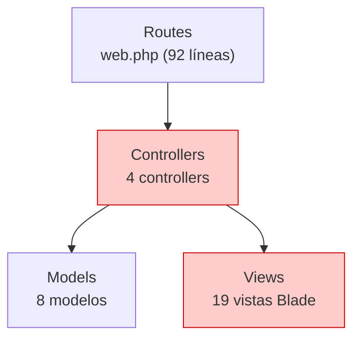
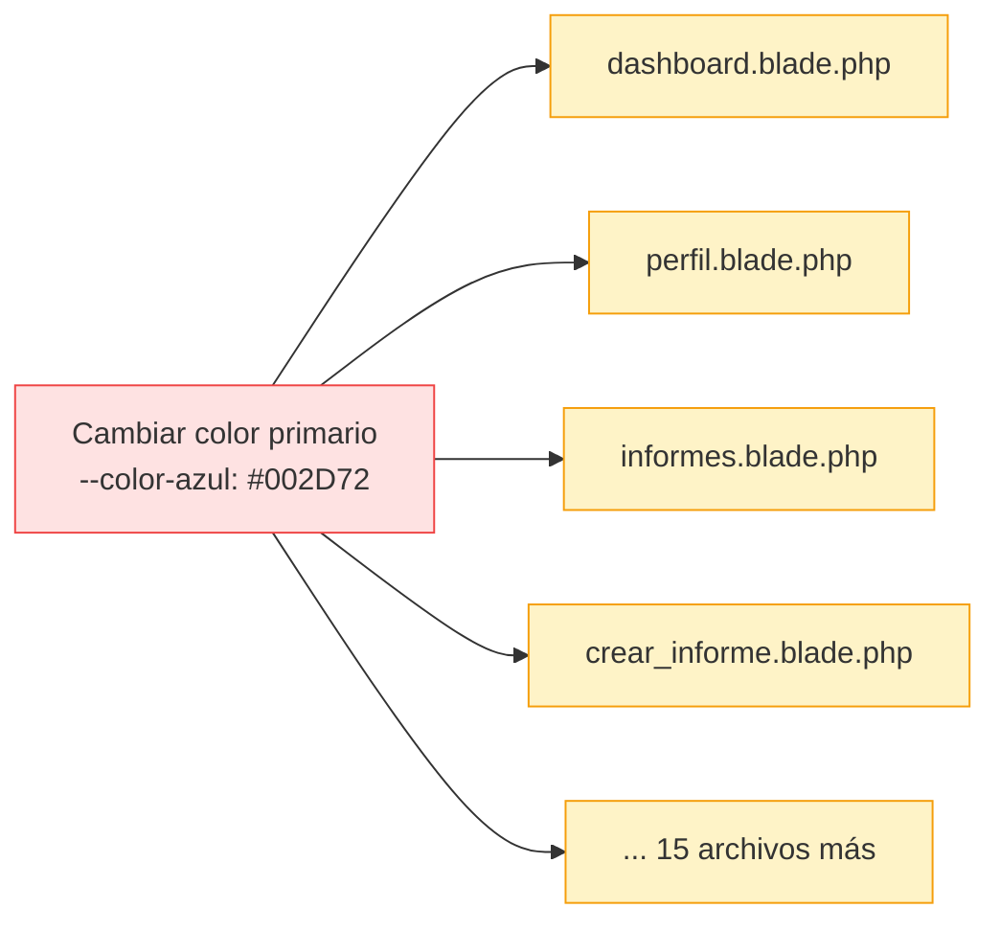
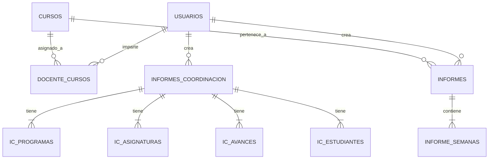

# Análisis de Calidad — Farusac Sistema de Informes (Backend + Frontend)

> [!IMPORTANT]
> Análisis integral de calidad del código, arquitectura, modelo MVC y frontend. Se evalúan **14 áreas** con calificación de 1 a 5 y un puntaje global.

---

## Resumen Ejecutivo

| Categoría | Puntaje | Estado |
|-----------|:-------:|--------|
| **Arquitectura Backend (MVC)** | 2.5 / 5 | 🟡 Necesita mejoras |
| **Modelos y Base de Datos** | 3.5 / 5 | 🟢 Aceptable |
| **Frontend / Vistas** | 2.0 / 5 | 🔴 Problemático |
| **Seguridad** | 3.0 / 5 | 🟡 Necesita mejoras |
| **Mantenibilidad** | 2.0 / 5 | 🔴 Problemático |
| **Puntaje Global** | **2.6 / 5** | 🟡 |

---

## PARTE I — BACKEND

### 1. Arquitectura MVC — Aplicación del patrón (2.5/5) 🟡



#### ✅ Lo que se hace bien:
- **Los modelos son limpios** — cada uno tiene `$fillable`, `$casts` y relaciones Eloquent correctas
- **Las rutas usan middleware de autenticación y roles** — buena separación de permisos
- **Se usan transacciones `DB::beginTransaction()`** para operaciones multi-tabla

#### ❌ Violaciones del patrón MVC:

| Problema | Dónde ocurre | Impacto |
|----------|-------------|---------|
| **Lógica de negocio en Controllers** | `AdminController` (1540 líneas), `CoordinadorController` (893 líneas) | El patrón MVC requiere que los controllers sean delgados — solo orquestan. Parseo de CSV, generación de PDF, determinación de semestres, detección de jornadas... todo debería estar en una **capa Service** |
| **Herencia Controller ≠ Herencia de rol** | `CoordinadorController extends DocenteController` | Un coordinador NO ES un docente con más funciones; tiene responsabilidades distintas. Usar herencia aquí **viola la responsabilidad única** y causa acoplamiento alto |
| **No hay Form Requests** | Todas las validaciones están inline en controllers | Laravel provee `FormRequest` para encapsular validación + autorización fuera del controller |
| **No hay API Resources / Transformers** | Los arrays JSON se construyen manualmente | Hace que cambiar el formato de respuesta requiera editar muchos métodos |

**Estructura recomendada vs actual:**

````carousel
```
ACTUAL (plano):
app/
  Http/Controllers/
    AdminController.php       ← 1540 líneas, hace TODO
    CoordinadorController.php ← 893 líneas, hereda de Docente
    DocenteController.php     ← 486 líneas
    AuthController.php        ← 97 líneas ✅
  Models/ (8 archivos)        ← Bien estructurados ✅
```
<!-- slide -->
```
RECOMENDADO (capas separadas):
app/
  Http/
    Controllers/              ← Solo orquestar (< 200 líneas c/u)
    Requests/                 ← Form Requests para validación
    Resources/                ← API Resources para JSON
  Services/                   ← Lógica de negocio
    CargaAcademicaService.php
    InformeService.php
    PdfGeneratorService.php
    ZipExportService.php
  Enums/
    Rol.php                   ← ✅ Ya creado
  Models/ (8 archivos)        ← Sin cambios
```
````

---

### 2. Modelos y Relaciones (3.5/5) 🟢

#### ✅ Aspectos positivos:

- **Relaciones bien definidas** — `belongsTo`, `hasMany`, `belongsToMany` con nombres claros
- **`$casts` correctos** — booleans, integers, datetimes
- **`$fillable` explícito** en todos los modelos (protección contra mass-assignment)
- **Foreign keys con `onDelete('cascade')`** en migraciones — integridad referencial

#### ❌ Problemas encontrados:

**2.1 — Migración default `users` vs tabla real `usuarios`**

La migración default de Laravel crea la tabla `users`:
```php
// 0001_01_01_000000_create_users_table.php
Schema::create('users', function (Blueprint $table) { ... });
```

Pero el modelo `User` apunta a `usuarios`:
```php
// User.php
protected $table = 'usuarios';
```

No hay migración que cree la tabla `usuarios` con las columnas reales (`nombre`, `correo`, `numero`, `rol`, `plaza`, `area`, `estado`, `google_id`). Esto implica que **la base de datos se creó manualmente o con una migración externa no versionada** — viola el principio de que las migraciones deben ser la fuente única de verdad del esquema.

**2.2 — `UPDATED_AT = null` en User**

```php
// User.php
const UPDATED_AT = null; // Desactiva updated_at
```

Esto impide rastrear cuándo se modificó un usuario. Es un anti-patrón si el modelo se actualiza frecuentemente (y sí lo hace — roles, área, registro personal).

**2.3 — No hay Soft Deletes**

Cuando se elimina un informe o un curso, se pierde permanentemente. Para un sistema institucional, debería usarse `SoftDeletes` para mantener trazabilidad:

```php
use Illuminate\Database\Eloquent\SoftDeletes;

class Informe extends Model {
    use SoftDeletes;
}
```

**2.4 — Falta de Scopes reutilizables**

Filtros como "informes enviados del mes X" se repiten en múltiples controllers. Deberían ser scopes del modelo:

```php
// En Informe.php (NO existe actualmente)
public function scopeDelMes($query, $mes) {
    return $query->whereRaw('LOWER(TRIM(mes)) = ?', [mb_strtolower(trim($mes))]);
}
```

---

### 3. Rutas y Autorización (3.0/5) 🟡

#### ✅ Bien:
- Rutas organizadas por rol con middleware `role:`
- Métodos HTTP correctos (`GET`, `POST`, `PUT`, `DELETE`)
- Rutas nombradas (`->name(...)`) usadas consistentemente

#### ❌ Problemas:

**3.1 — Coordinador no puede acceder a rutas de docente**

Las rutas de docente están protegidas con `middleware('role:docente')` y las de coordinador con `middleware('role:coordinador')`. Pero `CoordinadorController extends DocenteController` y el coordinador necesita funciones de docente.

Esto se "resuelve" **duplicando cada ruta** para ambos roles:

```php
// Docente
Route::get('/docente/informes/crear', [DocenteController::class, 'crearInformeView']);
// Coordinador (misma funcionalidad, ruta duplicada)
Route::get('/coordinador/informes/crear', [CoordinadorController::class, 'crearInformeView']);
```

**Solución correcta:** Usar un solo middleware que acepte múltiples roles:
```php
Route::middleware('role:docente,coordinador')->group(function () {
    // rutas compartidas
});
```

**3.2 — Parámetros `{id}` sin tipado**

Las rutas usan `{id}` genérico. Laravel soporta **Route Model Binding** que valida automáticamente:
```php
// ❌ Actual
Route::get('/admin/informes/docente/{id}/ver', ...);
// ✅ Recomendado
Route::get('/admin/informes/docente/{informe}/ver', ...);
// Controller recibe el modelo directamente:
public function verInformeDocente(Informe $informe) { ... }
```

---

### 4. Seguridad (3.0/5) 🟡

| Aspecto | Estado | Detalle |
|---------|--------|---------|
| CSRF protection | ✅ | `@csrf` en formularios, `csrf-token` en meta tags |
| Auth middleware | ✅ | Todas las rutas protegidas excepto login/callback |
| Validación de input | ✅ | `$request->validate()` en operaciones de escritura |
| SQL Injection | ✅ | Se usa Eloquent/Query Builder (parametrizado) |
| `exec()` sin escapar | ⚠️ | `AdminController:1029` — ver reporte anterior |
| XSS en Blade | ⚠️ | Se usa `{{ }}` (escapa HTML) pero hay `{!! !!}` en algunas vistas |
| `.env` con secretos en repo | 🔴 | El archivo `.env` contiene `GOOGLE_CLIENT_SECRET` — si el repo es público, es una filtración crítica |
| Exposición de errores | ⚠️ | Los `catch` devuelven `$e->getMessage()` al usuario — en producción esto puede exponer información interna de la DB |

> [!CAUTION]
> **GOOGLE_CLIENT_SECRET** está visible en el `.env` del repositorio. Si este `.env` fue commiteado a Git en algún momento, el secreto ya está comprometido y debe ser rotado en Google Cloud Console.

---

## PARTE II — FRONTEND (Vistas Blade)

### 5. Arquitectura Frontend (2.0/5) 🔴

Esta es la **debilidad más grave** del proyecto. El frontend viola casi todos los principios de mantenibilidad y reutilización de Blade.

#### 5.1 — No se usa el sistema de Layouts de Blade

**Cada una de las 19 vistas es un archivo HTML completo** con `<!DOCTYPE>`, `<head>`, `<body>`, y la totalidad del CSS inline. No se usa `@extends`, `@section`, `@yield` ni `@component`.

| Vista | Líneas | CSS inline (~%) |
|-------|-------:|---------------:|
| `admin/informes.blade.php` | 2606 | ~60% |
| `coordinador/crear_informe_coordinacion.blade.php` | 2177 | ~55% |
| `coordinador/dashboard.blade.php` | 1826 | ~60% |
| `admin/carga_datos.blade.php` | 1856 | ~55% |
| `admin/cursos.blade.php` | 1426 | ~50% |
| `docente/crear_informe.blade.php` | 1403 | ~50% |
| `coordinador/crear_informe.blade.php` | 1403 | ~50% |
| **TOTAL vistas** | **~23,389** | — |

> [!WARNING]
> El CSS de `header`, `sidebar`, `modal`, `toast`, `variables :root` y `tipografías` está **copiado identicamente en cada vista**. Cualquier cambio de diseño (por ejemplo, cambiar el color azul institucional) requiere editar **19 archivos** manualmente.

**Impacto de la duplicación:**



#### 5.2 — No se usan Blade Components ni Partials

Elementos repetidos en múltiples vistas que deberían ser componentes:

- **Header** (logo + avatar + dropdown) → `@include('partials.header')`
- **Sidebar** (nav links) → `@include('partials.sidebar', ['active' => 'inicio'])`
- **Toast notification** → `<x-toast />`
- **Modal de confirmación** → `<x-confirm-modal />`
- **Tabla de informes** → `<x-informe-table :informes="$informes" />`

#### 5.3 — JavaScript incrustado sin separación

Todo el JavaScript (~200-400 líneas por vista) está en tags `<script>` al final de cada vista. No se usa Vite/webpack para empaquetar. Esto significa:
- Sin minificación en producción
- Sin cache-busting de assets
- Sin tree-shaking
- Los archivos `resources/js/app.js` y `resources/css/app.css` existen pero **no se usan**

#### 5.4 — Variables CSS inconsistentes entre vistas

| Variable | `dashboard` (docente) | `perfil` (docente) | `dashboard` (admin) |
|----------|:---------------------:|:------------------:|:-------------------:|
| `--color-oro` | `#AC8400` | `#AC8400` | ❌ `--color-dorado` |
| `--color-fondo` | `#f8fafc` | `#f4f7fa` ❌ | `#f7fafc` ❌ |
| `--shadow-premium` | `rgba(0,45,114,0.05)` | `rgba(0,45,114,0.04)` ❌ | `rgba(0,45,114,0.05)` |

Hay inconsistencias sutiles de nombres y valores entre vistas que son difíciles de detectar y causan diferencias visuales no intencionadas.

---

### 6. Vistas duplicadas docente/coordinador (1.5/5) 🔴

Los archivos de vistas del coordinador **son copias casi idénticas** de las del docente:

| Docente | Coordinador | Diferencia real |
|---------|-------------|-----------------|
| `docente/crear_informe.blade.php` (1403 líneas) | `coordinador/crear_informe.blade.php` (1403 líneas) | Solo cambian las rutas de los links del sidebar |
| `docente/historial_informes.blade.php` (1109 líneas) | `coordinador/historial_informes.blade.php` (970 líneas) | Sidebar links + tabla de coordinación adicional |
| `docente/perfil.blade.php` (793 líneas) | `coordinador/perfil.blade.php` (772 líneas) | Campo "Área" adicional |

**~3500 líneas de código son pura duplicación** con < 5% de diferencia. Esto podría resolverse con un layout compartido y condicionales `@if($user->rol === 'coordinador')`.

---

## PARTE III — MODELO DE DATOS

### 7. Diseño del esquema de base de datos (3.5/5) 🟢



#### ✅ Aspectos positivos:
- **Relaciones N:M bien modeladas** (`docente_cursos` como tabla pivote)
- **Normalización adecuada** — los sub-datos de informes están en tablas separadas
- **Foreign keys con cascada** — integridad referencial garantizada
- **Datos tipados correctamente** — booleans, integers, timestamps

#### ❌ Problemas:

| Problema | Detalle |
|----------|---------|
| **Mes y periodo como strings libres** | `'mes' => 'Octubre'`, `'periodo' => 'Segundo Semestre 2026'` — No hay tabla de catálogo ni enum. Comparaciones requieren normalización manual (`LOWER(TRIM(mes))`) |
| **Estado como string libre** | `'estado' => 'enviado'` — Debería ser un Enum o tabla de catálogo |
| **Migración fantasma de `usuarios`** | La tabla real `usuarios` no tiene migración en el repositorio |
| **No hay índices personalizados** | Campos frecuentemente filtrados (`mes`, `periodo`, `estado`, `anio`, `carrera`, `area`) no tienen índices declarados en las migraciones |

---

## PARTE IV — RESUMEN DE ACCIONES PRIORITARIAS

### Prioridad 1 — Impacto inmediato

| # | Acción | Esfuerzo | Beneficio |
|---|--------|----------|-----------|
| 1 | **Crear layout Blade maestro** con header, sidebar, CSS y JS compartidos | 4-6 horas | Elimina ~15,000 líneas duplicadas |
| 2 | **Mover CSS a un archivo externo** (`public/css/app.css` o Vite) | 2-3 horas | Mantenibilidad + performance (cache del navegador) |
| 3 | **Mover JS a archivos externos** por módulo | 3-4 horas | Mantenibilidad + minificación en prod |

### Prioridad 2 — Calidad del Backend

| # | Acción | Esfuerzo | Beneficio |
|---|--------|----------|-----------|
| 4 | **Extraer Services** (CSV, PDF, ZIP) del AdminController | 4-6 horas | Controllers de < 200 líneas |
| 5 | **Romper herencia Controller** — Coordinador NO debe extender Docente | 2-3 horas | Desacoplamiento de responsabilidades |
| 6 | **Crear Form Requests** para validaciones | 2-3 horas | Validación + autorización centralizada |
| 7 | **Agregar Scopes a modelos** para filtros recurrentes | 1-2 horas | DRY en consultas |

### Prioridad 3 — Robustez

| # | Acción | Esfuerzo | Beneficio |
|---|--------|----------|-----------|
| 8 | **Crear migración de `usuarios`** real | 1 hora | Reproducibilidad del esquema |
| 9 | **Agregar SoftDeletes** a Informe e InformeCoordinacion | 30 min | Trazabilidad institucional |
| 10 | **Agregar índices a BD** para campos filtrados frecuentemente | 30 min | Performance |
| 11 | **No exponer `$e->getMessage()`** al usuario en producción | 1 hora | Seguridad |
| 12 | **Completar deduplicación de ZIP** (agente fallido) | 30 min | DRY |

---

## Calificación Final

```
                    Backend                    Frontend
    ┌─────────────────────┐    ┌─────────────────────┐
    │ Modelos      ██████░ │    │ Layouts     █░░░░░░ │
    │ Rutas        █████░░ │    │ CSS         █░░░░░░ │
    │ Controllers  ███░░░░ │    │ JS          ██░░░░░ │
    │ Seguridad    ████░░░ │    │ Components  ░░░░░░░ │
    │ Validación   █████░░ │    │ Duplicación █░░░░░░ │
    └─────────────────────┘    └─────────────────────┘

    Puntaje Global:  2.6 / 5  ─  Funcional pero con deuda técnica alta
```

> [!TIP]
> La **acción de mayor impacto** es crear un layout Blade maestro. Con ~6 horas de trabajo se eliminan ~15,000 líneas duplicadas y se establece una base mantenible para todo cambio futuro de UI.
